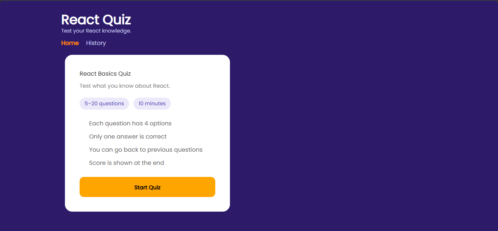
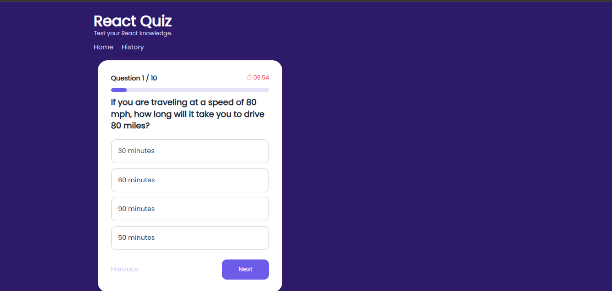

# React Quiz App

A quiz app where you choose your settings, answer questions from the Open Trivia DB API against a 10-minute timer, and see your past results.

🔗 **Live link:** [paste your Vercel link here]

## Screenshots


|---|---|
|  |
|  | 

## Features

- Quiz settings form: name, category, difficulty and number of questions, with validation and clear error messages
- Questions loaded from the Open Trivia DB API, with loading, error and "no questions" states
- 10-minute countdown timer that submits the quiz automatically at 00:00
- Progress bar, score, and correct and wrong answers shown in green and red
- Result page with your name, settings, score and time taken
- History of past quizzes, saved in the browser so it stays after a refresh
- Page refresh works on every route, and a 404 page for unknown addresses
- Responsive design for desktop and mobile

## Tech stack

- React
- TypeScript
- React Router
- Context API with `useReducer`
- Tailwind CSS
- Vite
- API: [Open Trivia DB](https://opentdb.com/)
- Deployed on Vercel

## Run locally

```bash
git clone [your repo link]
cd Quiz-App
npm install
cp .env.example .env
```

Open `.env` and set the API address:

```
VITE_API_URL=https://opentdb.com/api.php
```

Then start the app:

```bash
npm run dev
```

Open http://localhost:5173 in your browser.

To check the types and create a production build:

```bash
npm run build
```

## Note about the API

Open Trivia DB allows only one request every 5 seconds. If you see "Too many requests", wait a few seconds and click **Try Again**.

## Project structure

```
src/
├── components/     Header, QuestionScreen, ResultScreen
├── context/        QuizContext (state, reducer and actions)
├── hooks/          useTimer, useLocalStorage
├── pages/          Home, Quiz, Result, History, NotFound
├── types/          shared TypeScript types
├── api.ts          the API call
└── categories.ts   category list
```

## What I learned

- **Phase 1:** building a page from separate components and passing data with props.
- **Phase 2:** `useState` and events, lists with `.map()` and keys, and never changing state directly.
- **Phase 3:** loading data with `useEffect` and `async/await`, and handling loading and error states.
- **Phase 4:** React Router: separate pages, `Link` and `NavLink`, and redirecting when no quiz has started.
- **Phase 5:** Context with `useReducer`, and custom hooks (`useTimer`, `useLocalStorage`).
- **Phase 6:** form validation with clear error messages, and converting plain CSS to Tailwind.
- **Phase 7:** shared state with actions and selectors, moving state out of components.
- **Phase 8:** TypeScript with React, environment variables and deploying the app.